# AI Hiring Intelligence Platform

An explainable recruitment platform that evaluates candidates against job descriptions using evidence retrieved from their resumes. Every score traces back through **Requirement → Evidence → Reasoning → Confidence → Decision**, and the deterministic path produces a complete report with no LLM configured.

The repository is a polyglot monorepo. A single React application fronts three independent backend services.

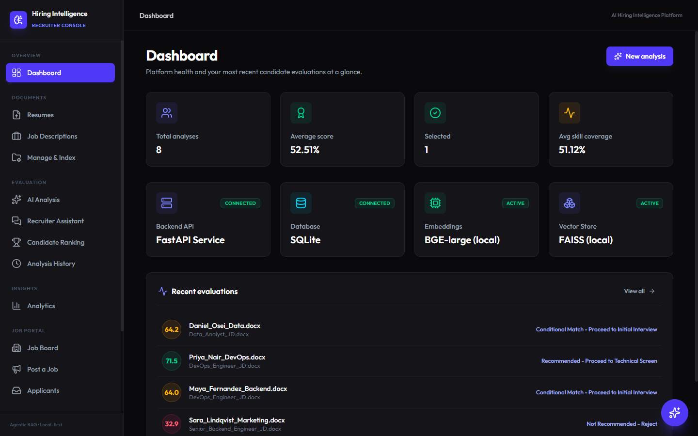

> All names, employers and contact details in the screenshots are fictional sample data. They were captured from a local run with no LLM, Qdrant, or Postgres connected.

## Contents

- [Overview](#overview)
- [Screenshots](#screenshots)
- [System architecture](#system-architecture)
- [Technology stack](#technology-stack)
- [Data architecture](#data-architecture)
- [How the platform works](#how-the-platform-works)
- [Getting started](#getting-started)
- [Configuration](#configuration)
- [API reference](#api-reference)
- [Testing](#testing)
- [Deployment](#deployment)
- [Security considerations](#security-considerations)
- [Known issues and limitations](#known-issues-and-limitations)
- [Repository structure](#repository-structure)
- [Further documentation](#further-documentation)

## Overview

| Component | Path | Stack | Port | Audience and purpose |
|---|---|---|---|---|
| **Web application** | `ai_hiring_platform/frontend` | React 19, TypeScript, Vite, Tailwind | 5173 | The single website for recruiters and candidates |
| **Hiring backend** | `ai_hiring_platform/backend` | Python, FastAPI, LangGraph, FAISS, SQLite | 8000 | Recruiters: evaluation, ranking, assistant, analytics |
| **Job Portal API** | `job_portal/backend` | .NET 9, ASP.NET Core, SignalR, EF Core | 5290 | Candidates: job board, matching, applications, career assistant |
| **Company Intelligence** | `company_intel` | Python, FastAPI, Qdrant | 8123 | Answers questions from crawled company websites |
| Personality predictor (legacy) | `src`, `data` | Python, scikit-learn, Streamlit | Streamlit default | Earlier standalone project, unrelated to the platform |

`job_portal/frontend` is retired. Its pages were folded into the main web application, and the folder is kept for reference and CI only.

### Core capabilities

**For recruiters**

- Upload resumes and job descriptions (PDF or DOCX), with duplicate detection by SHA-256
- Explainable evaluation of one resume against one job description, with a nine-parameter Match Score
- Authenticity checks that flag skills listed but never demonstrated
- Skill gaps, learning roadmap, interview questions, and a rejection email draft
- Multi-candidate ranking with CSV export
- Recruiter Assistant: evidence-backed questions across the whole resume pool, with guardrails
- Pipeline stages, notes, searchable history, and JSON or PDF report export
- Analytics on scores, recommendations, trends, and common skill gaps
- Model Lab to compare embedding models, and Prompt Lab to test system prompts rule by rule

**For candidates**

- Job board with filters, and job posting by document upload or form
- Career Assistant popup that streams its progress, scores matches, and can drive the UI
- Three scoring modes: Fast score, AI evaluation, and RAG
- Applications with a mandatory review step and a fit score frozen at submission

## Screenshots

### Evaluation

**Candidate report**: score, workflow stage, seniority fit, authenticity, and skill analysis.

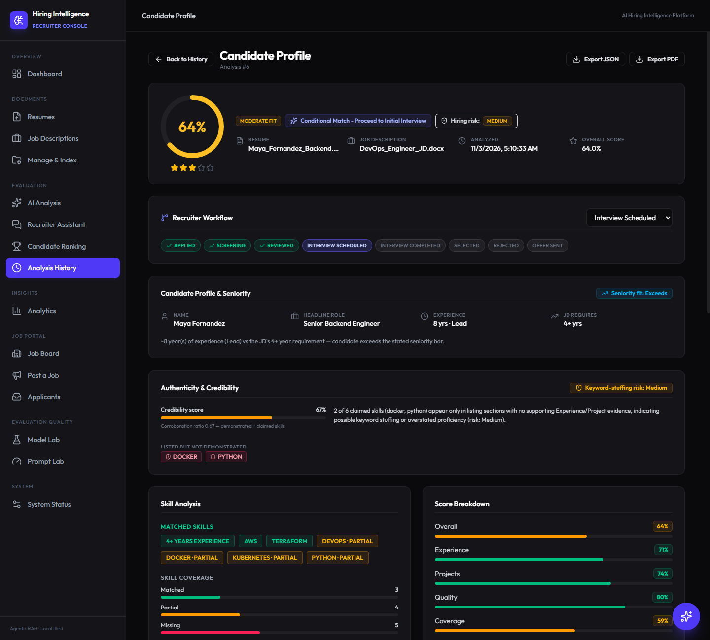

**Candidate ranking**: many resumes scored against one job description.

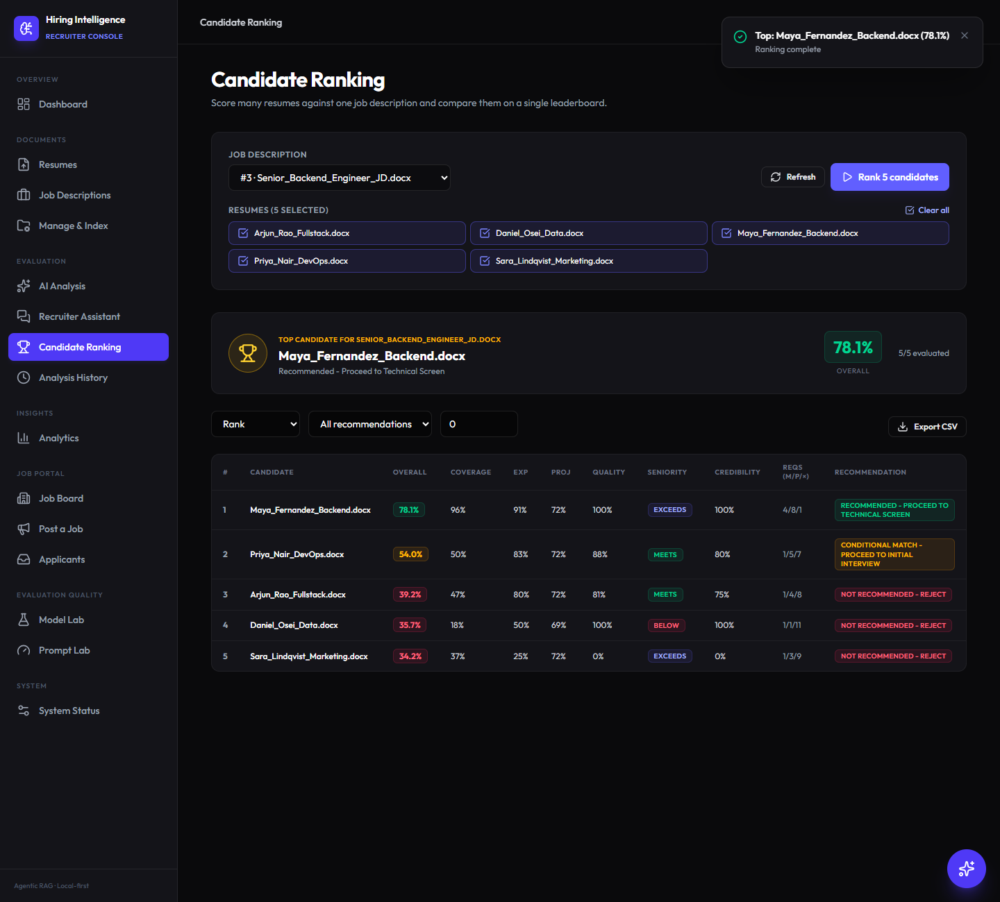

**Recruiter Assistant**: a pool-wide question answered with the evidence behind each score.

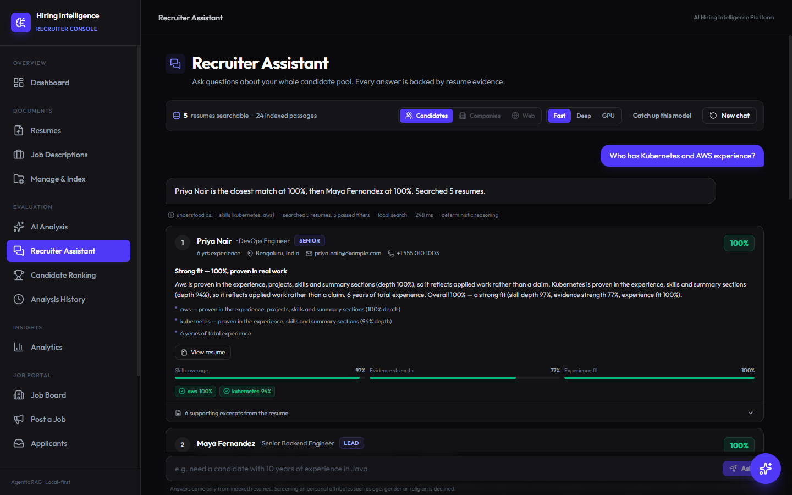

**Analysis history**: search, filter, and sort every evaluation.

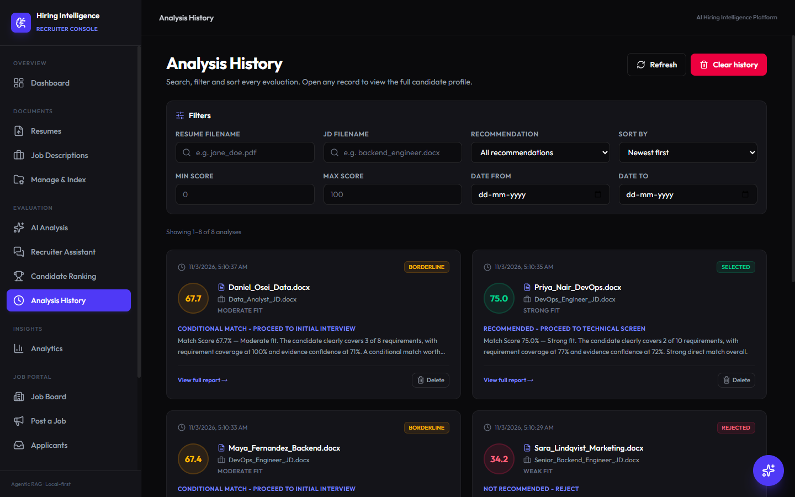

### Documents and insights

**Resume upload**

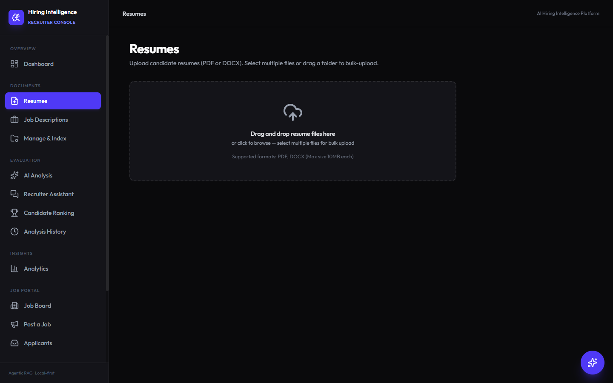

**Manage & Index**: choose the working set and which embedding models index it.

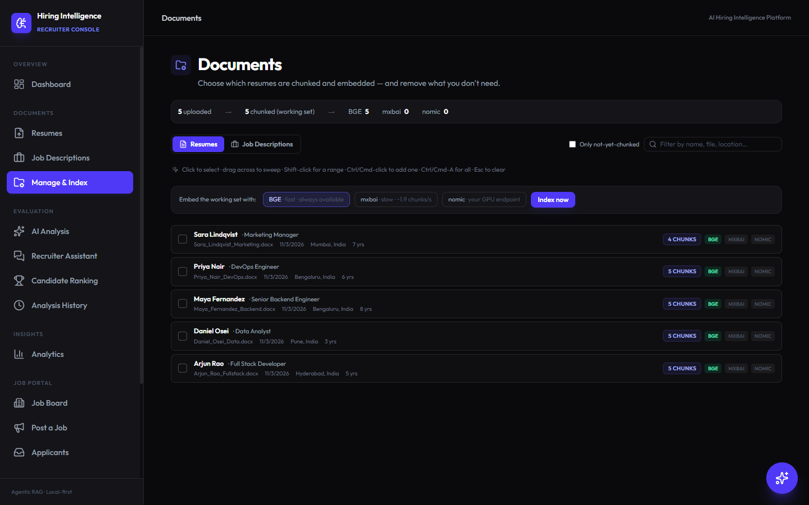

**Analytics**

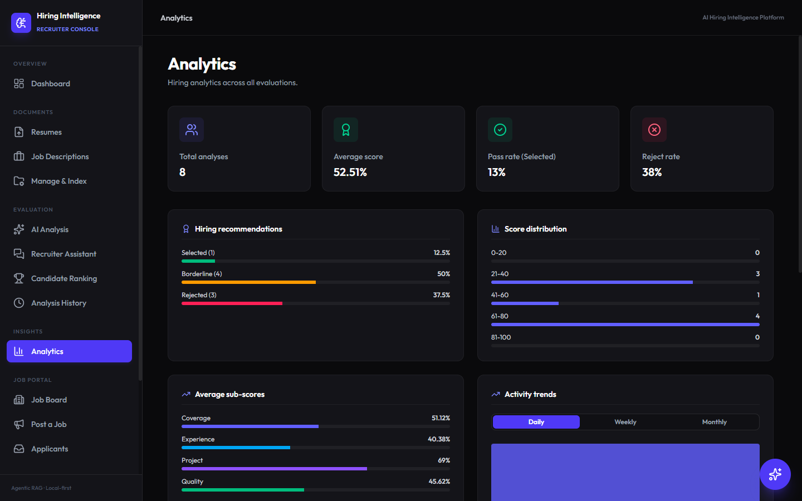

### Job portal

**Job board**

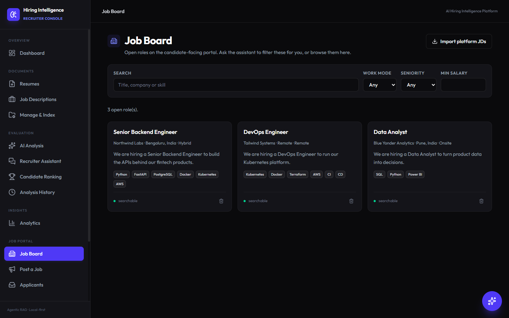

**Career Assistant**: available from every page, with a selectable scoring mode.

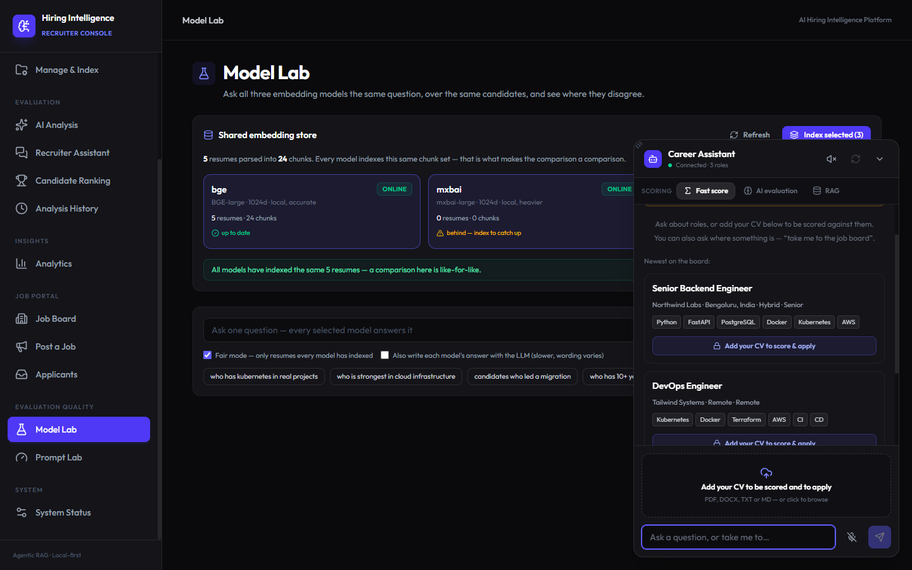

**Applicants**: the fit score captured at the moment of application.

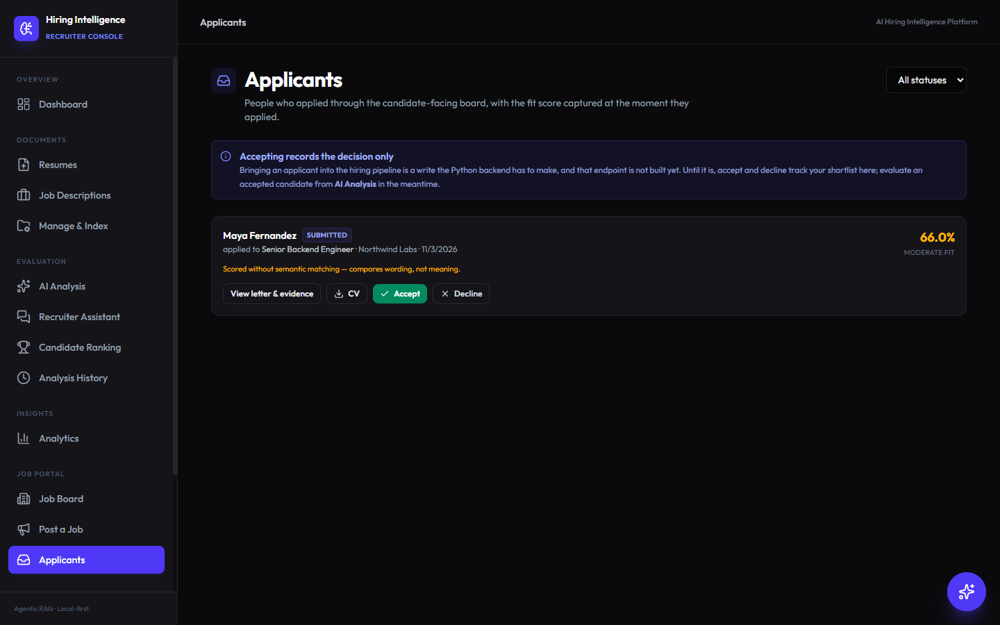

### Quality and operations

**Model Lab**

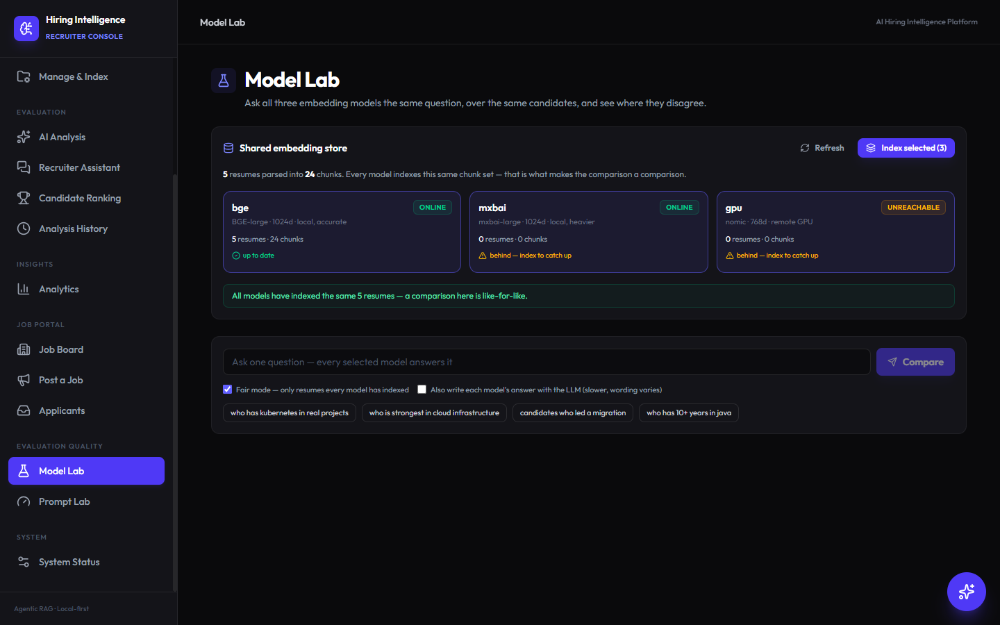

**Prompt Lab**

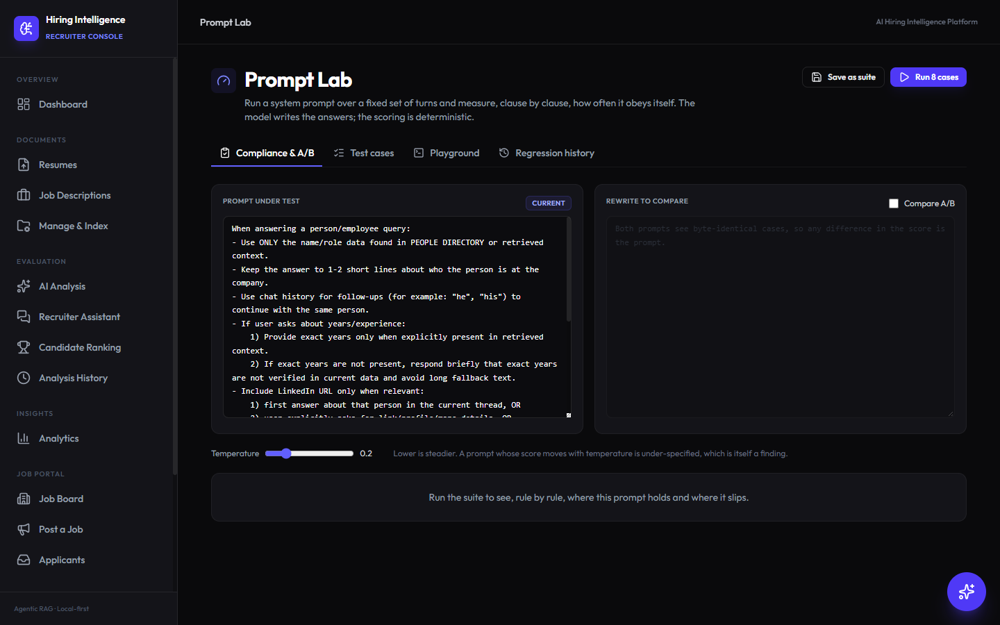

**System Status**

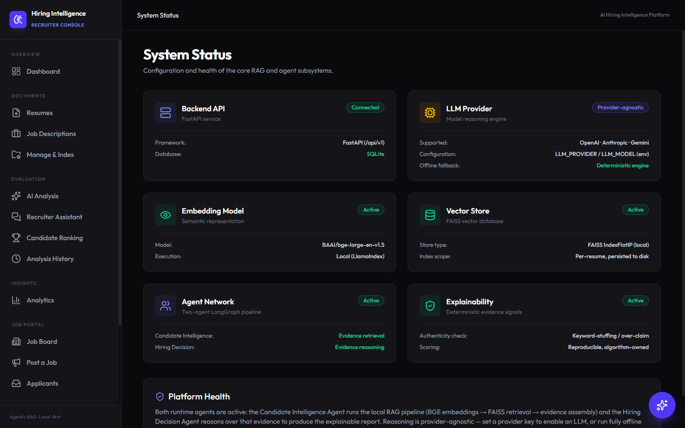

## System architecture

The browser talks to each backend directly, using a separate base URL for each. The services share no code. The only shared resource is one SQLite file used by the hiring backend and the Job Portal API, with separate table sets.

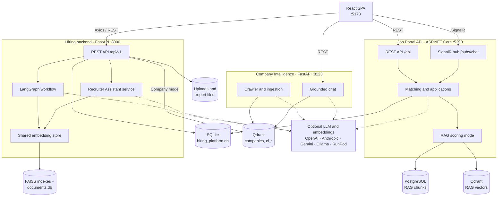

Dashed lines are optional. Without an LLM, the hiring backend and Job Portal API fall back to deterministic logic, and Company Intelligence quotes retrieved passages directly.

### Design principles

- **Evidence before reasoning.** Evidence is retrieved before any reasoning runs.
- **The LLM never supplies a fact or a requirement.** Names, scores, years, and quotes come from deterministic retrieval, and `ground_candidates` removes anything not tied to an indexed resume.
- **Algorithms where results must be reproducible.** Embeddings, search, scoring, and classification are deterministic. Narrative text is the LLM's job.
- **Exactly two runtime agents.** One gathers evidence and the other decides. The Recruiter Assistant is a service, not a third agent.
- **No hardcoded skill vocabulary.** Terms are resolved against the indexed corpus rather than a maintained skill list.
- **Silence is neutral.** A requirement the job description never stated cannot sink a candidate.

## Technology stack

| Layer | Technologies |
|---|---|
| Frontend | React 19, TypeScript 6, Vite 8, Tailwind CSS 4, Axios, `@microsoft/signalr`, `react-markdown`, Vitest, oxlint |
| Hiring backend | Python 3.12, FastAPI, Uvicorn, Pydantic 2, SQLAlchemy 2, LangGraph, LlamaIndex, FAISS (`faiss-cpu`), FastEmbed (ONNX), PyMuPDF, `python-docx`, `openpyxl`, `qdrant-client`, pytest |
| Job Portal API | .NET 9, ASP.NET Core, SignalR, EF Core (SQLite and PostgreSQL), `Qdrant.Client`, PdfPig, `DocumentFormat.OpenXml`, Swashbuckle, xUnit |
| Company Intelligence | Python, FastAPI, `qdrant-client`, httpx, trafilatura, selectolax, FastEmbed, APScheduler, Playwright (optional rendering), pytest |
| Datastores | SQLite, FAISS flat indexes, PostgreSQL 16, Qdrant 1.12 |
| Infrastructure | Docker, Docker Compose, Render Blueprint, Hugging Face Spaces, GitHub Actions |

### LLM and embedding providers

All LLM use is optional and selected through configuration.

**Reasoning (hiring backend):** OpenAI, Anthropic, Google Gemini, or any OpenAI-compatible endpoint such as Ollama or RunPod. `LLM_RUNTIME` chooses between `auto`, `ollama`, `runpod`, and `api`.

**Embedding models (hiring backend):**

| Engine | Model | Dimensions | Runs | Default cosine floor |
|---|---|---|---|---|
| `bge` (default) | `BAAI/bge-large-en-v1.5` | 1024 | In-process, CPU (ONNX) | 0.62 |
| `mxbai` | `mixedbread-ai/mxbai-embed-large-v1` | 1024 | In-process, CPU (ONNX) | 0.537 |
| `gpu` | `nomic-embed-text` (configurable) | 768 | Remote Ollama-compatible endpoint | 0.51 |

Each model has its own index and calibrated floor because vectors and similarity ranges are not comparable across models.

## Data architecture

### Storage overview

| Store | Location | Contents | Owner |
|---|---|---|---|
| SQLite | `ai_hiring_platform/backend/hiring_platform.db` | Relational platform and portal data | Hiring backend and Job Portal API |
| SQLite | `<storage>/vectors/shared/documents.db` | Parsed resume profiles and chunks | Hiring backend |
| FAISS | `<storage>/vectors/shared/vectors-<model>.faiss`, `rows-<model>.json` | One flat inner-product index per model, over the same chunks | Hiring backend |
| Files | `<storage>/uploads`, `reports`, `exports` | Original documents, report JSON, exports | Hiring backend |
| Files | `job_portal/backend/JobPortal.Api/storage/resumes` | Resumes uploaded by candidates | Job Portal API |
| PostgreSQL | `ragdb` | `rag_chunks`, `rag_ingest_state` | Job Portal API, RAG mode only |
| Qdrant | `resume_chunks`, `job_chunks` | Vectors for RAG mode | Job Portal API, RAG mode only |
| Qdrant | `companies` | One point per company field | Hiring backend, company mode only |
| Qdrant | `ci_companies`, `ci_sources`, `ci_content` | Registry, crawl state, and page chunks | Company Intelligence |

`<storage>` is `STORAGE_DIR`, which defaults to `ai_hiring_platform/storage`.

### Shared SQLite schema

The two services share one file with separate table sets. Python owns the unprefixed tables. .NET owns everything prefixed `portal_`, and reads only `resumes` and `job_descriptions` from the Python side.

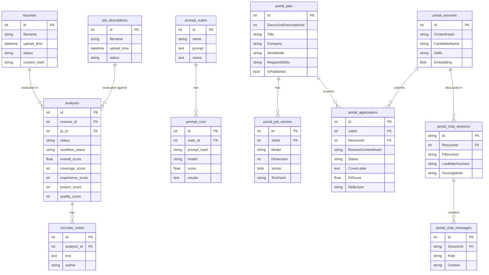

### Schema management

| Store | Approach |
|---|---|
| Python tables | `create_all` at startup, plus idempotent `ALTER TABLE` statements in `ensure_schema()` for later columns. `alembic` is listed as a dependency, but the platform has no migrations. |
| `portal_*` tables | Raw `CREATE TABLE IF NOT EXISTS` in `PortalSchemaInitializer`, so EF migrations never claim ownership of the shared file. |
| RAG PostgreSQL | EF Core migrations, applied at startup. Failure is logged and is not fatal. |
| Qdrant | Collections are created at startup. `resume_chunks` and `job_chunks` are aliases, which allows re-embedding without downtime. |

### Connection patterns

| From | To | Mechanism |
|---|---|---|
| Frontend | Hiring backend | Axios at `VITE_API_BASE` + `/api/v1`. Same origin in a production build. |
| Frontend | Job Portal API | `fetch` at `VITE_PORTAL_API_BASE`, plus SignalR at `/hubs/chat` |
| Frontend | Company Intelligence | `fetch` at `VITE_COMPANY_INTEL_URL` |
| Hiring backend | SQLite | SQLAlchemy session per request via `get_db` |
| Hiring backend | FAISS | In-process, loaded from disk |
| Job Portal API | SQLite | EF Core `PortalDbContext` |
| Job Portal API | PostgreSQL | EF Core `RagDbContext` with retry on failure |
| Job Portal API | Qdrant | gRPC on port 6334 |
| Company Intelligence and hiring backend | Qdrant | `qdrant-client` over HTTP |
| Job Portal API | Ollama | Named `HttpClient`s against the native `/api/chat`, with no `/v1` suffix |

The hiring backend wraps responses as `{ success, message, data, meta }`, and the other two services use a similar envelope. File exports stream raw bytes.

## How the platform works

### Evaluation pipeline

The LangGraph workflow in `workflows/hiring_workflow.py` is strictly sequential: `START → candidate_intelligence → hiring_decision → END`.

```mermaid
flowchart LR
    Doc["Resume + JD<br/>PDF or DOCX"] --> Parse["Parse"]
    Parse --> Chunk["Section-aware<br/>chunking"]
    Chunk --> Embed["Embed once<br/>per model"]
    Embed --> Index["FAISS index"]
    Index --> Req["Extract JD<br/>requirements"]
    Req --> Retrieve["Hybrid retrieval"]
    Retrieve --> Agent1["Candidate<br/>Intelligence Agent"]
    Agent1 --> Evidence["Evidence<br/>package"]
    Evidence --> Agent2["Hiring Decision<br/>Agent"]
    Agent2 --> Report["Hiring report"]
```

| Agent | Does | Never does |
|---|---|---|
| **Candidate Intelligence** | Parses, retrieves, ranks evidence, assembles the evidence package | Makes hiring decisions |
| **Hiring Decision** | Computes scores and produces the recommendation, roadmap, questions, and email | Reads documents, searches FAISS, or computes embeddings |

### Retrieval

- **Chunking:** section-aware and sentence-aware, targeting 350 characters with a 600 maximum and one sentence of overlap.
- **Hybrid search:** dense cosine and sparse BM25 rankings are combined with Reciprocal Rank Fusion, weighted 0.6 and 0.4 with `k = 60`.
- **Evidence ranking:** similarity 70%, section 15%, technical specificity 10%, density 5%.
- **Optional LLM stage:** verification and re-ranking are off by default. The model can only judge text that retrieval already returned, within a 20-second deadline.

### Match Score

The Match Score is deterministic, from 0 to 100, to one decimal place.

| Parameter | Weight | Parameter | Weight |
|---|---|---|---|
| Skill | 20% | Education | 8% |
| Experience | 15% | Location | 8% |
| Technology | 14% | Availability | 7% |
| Designation | 14% | Freshness | 5% |
| Industry | 9% | | |

| Score | Band | Dashboard bucket |
|---|---|---|
| 85–100 | Excellent fit | Selected |
| 70–84.9 | Strong fit | Selected |
| 50–69.9 | Moderate fit | Borderline |
| Below 50 | Weak fit | Rejected |

Skill Match reads the whole resume, including claims in the skills list. Technology Match reads only Experience and Projects, which is the evidence. The gap between them is a signal in its own right.

The report also carries sub-scores blended from coverage (40%), experience (25%), confidence (15%), projects (10%), and quality (10%). See [Match_Score.md](ai_hiring_platform/docs/Match_Score.md) for the full specification.

### Recruiter Assistant

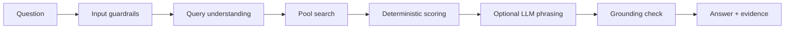

- **Four answer shapes:** a search, a fact about one person, an explanation of the previous answer, or a question back. Explanations reuse the stored result and never re-run retrieval.
- **Guardrails:** refuses out-of-scope questions, prompt injection, credential probes, abusive input, and screening on protected attributes.
- **Corpus-derived lexicon:** the indexed text decides whether a word is a skill, a place, or ordinary English.
- **Working set:** uploads of up to 20 files index automatically. Larger batches are stored until a recruiter selects them on the Manage & Index page.

### Job Portal

| Scoring mode | How it scores | Requires |
|---|---|---|
| Fast score (`computed`) | Semantic 50%, skill overlap 25%, title 15%, experience 10% | Nothing; a real embedding model makes it semantic |
| AI evaluation (`reasoned`) | A model judges the resume against the posting | Chat model |
| RAG (`rag`) | Retrieves passages per requirement, and a model judges only those passages | Chat and embedding models, PostgreSQL, Qdrant |

- **Streaming:** the `ChatHub` sends `Thought`, `Token`, `Matches`, `Suggestions`, `FollowUps`, `UiAction`, `Complete`, `Error`, and `End` events.
- **Copilot commands:** UI commands are validated on both server and client, with an allowlist for navigation routes.
- **Navigation:** the browser resolves navigation requests against the sidebar's route registry, so the assistant can only offer pages that exist.
- **Applications:** the flow is `preview → review → submit`. Each posting accepts one application per resume, keyed on content hash. Cover letters that mention a skill scored as missing, or contain contact details, are replaced by a composed letter.
- **Screening:** four yes/no questions derived from the posting are available at `/api/jobs/{id}/screening`.

### Company Intelligence

```text
register → frontier → fetch → extract → hash → chunk → embed → Qdrant
ask      → embed query → Qdrant search → fence → answer + citations
```

- **The chat path never crawls.** Answers depend only on Qdrant and the embedding model.
- **Refresh is cheap.** A `304` or an unchanged content hash stops the work before embedding. An hourly scheduler checks what is due; news refreshes every 2 days, products every 14, and other pages every 30.
- **Crawled text is untrusted.** Retrieved text is fenced, instruction-like spans are replaced, and credentials are redacted. Every claim carries its source URL.
- **The crawler is polite.** It honours `robots.txt` and rate limits, identifies itself, and does not bypass bot protection. LinkedIn URLs are stored as links and never crawled.

## Getting started

### Prerequisites

| Requirement | Used by | Notes |
|---|---|---|
| Python 3.12 | Python services | 3.12 is the version tested and used by the Dockerfile |
| Node.js 20+ | Frontend | Tested on 22; CI and Docker use 20 |
| .NET 9 SDK | Job Portal API | |
| Docker | RAG mode storage | Optional |

Allow several gigabytes of disk space for the embedding models, which download on first use. The first evaluation took about two minutes on a laptop CPU.

> **Windows:** keep the repository in a short path and create virtual environments inside each project. A deep path can exceed the 260-character limit and make `pip install` fail partway through.

The commands below use PowerShell, and each service needs its own terminal. Run them from the repository root.

### 1. Hiring backend

```powershell
cd ai_hiring_platform\backend
python -m venv .venv
.\.venv\Scripts\python.exe -m pip install -r requirements.txt
.\.venv\Scripts\python.exe -m uvicorn app.main:app --port 8000
```

API documentation is at <http://localhost:8000/docs>. No `.env` file is needed for local use. See the note about `RETRIEVAL_MIN_SIMILARITY` under [Configuration](#hiring-backend) before copying `.env.example`.

### 2. Frontend

```powershell
cd ai_hiring_platform\frontend
npm install
npm run dev
```

Open <http://localhost:5173>. The recruiter pages need only the hiring backend. The Job Portal and Web sections report when their service is unreachable.

### 3. Job Portal API (optional)

A fresh clone needs two workarounds, explained under [Known issues](#known-issues-and-limitations).

```powershell
# The build fails unless this gitignored file exists
Set-Content job_portal\frontend\.env "VITE_API_BASE=http://localhost:5290"

cd job_portal\backend\JobPortal.Api
$env:ASPNETCORE_ENVIRONMENT = "Development"
$env:ASPNETCORE_URLS = "http://localhost:5290"
dotnet run --no-launch-profile -- `
  "--Rag:PostgresConnectionString=Host=127.0.0.1;Port=5432;Database=ragdb;Username=raguser;Password=dev-only-change-me;Timeout=2" `
  "--Ollama:BaseUrl=" "--Ollama:ChatModel=" "--Ollama:EmbedModel=" `
  "--Portal:PythonStorageDir=..\..\..\ai_hiring_platform\storage"
```

Swagger is at <http://localhost:5290/swagger>, and `GET /api/health` reports which capabilities are active. This command runs in fallback mode with no models. Without a running Postgres, it logs connection errors and RAG mode is unavailable; the other modes still work.

To enable RAG mode, start its storage with `docker compose -f docker-compose.rag.yml up -d`, and also pass `--Rag:QdrantApiKey=dev-only-change-me` plus real chat and embedding model settings. That compose file binds both services to loopback only. Set real credentials before running it anywhere other than a laptop. This path was not exercised while preparing this document.

### 4. Company Intelligence (optional)

```powershell
cd company_intel
python -m venv .venv
.\.venv\Scripts\python.exe -m pip install -r requirements.txt
Copy-Item .env.example .env    # then set QDRANT_URL, QDRANT_API_KEY and the provider settings
.\.venv\Scripts\python.exe -m uvicorn app.main:app --port 8123
```

Without Qdrant, the service starts and `GET /api/v1/health` reports `degraded`. Set `EMBED_PROVIDER` and `EMBED_DIM` together, because a provider change means rebuilding the collection and re-crawling.

To preview extraction for a site without storing anything:

```powershell
.\.venv\Scripts\python.exe scripts\preview_crawl.py acme.com --max-pages 10 --show-chunks
```

### Helper scripts

| Command | Purpose |
|---|---|
| `.\run-all.ps1` | Starts Company Intelligence, the hiring backend, and the frontend in separate windows. It does **not** start the Job Portal API, and expects a `.venv` in each Python project. |
| `.\update-runpod.ps1 <pod-id>` | Verifies a RunPod endpoint, then updates its URL in both Python `.env` files |
| `python -m scripts.bulk_load_resumes <folder>` | Bulk-registers and indexes resumes (run from the hiring backend folder) |
| `python -m scripts.load_companies <file.xlsx>` | Loads a company spreadsheet into Qdrant, replacing the collection unless `--keep` is passed |

### Legacy personality predictor

This standalone Streamlit app predicts Big Five traits from resume text using TF-IDF and multi-output linear regression. It has no requirements file, and it was not run during the preparation of this document.

```powershell
pip install streamlit pandas scikit-learn joblib
streamlit run src/app.py
```

## Configuration

Every setting is optional unless noted. Secrets belong in `.env` files or environment variables, which are gitignored. Only `.env.example` templates are committed.

### Hiring backend

Full template: [`ai_hiring_platform/backend/.env.example`](ai_hiring_platform/backend/.env.example).

| Variable | Default | Purpose |
|---|---|---|
| `DATABASE_URL` | `sqlite:///<backend>/hiring_platform.db` | SQLAlchemy URL |
| `STORAGE_DIR` | `ai_hiring_platform/storage` | Uploads, vectors, reports, exports |
| `LLM_PROVIDER`, `LLM_MODEL` | `openai`, per-provider default | Hosted reasoning provider |
| `OPENAI_API_KEY`, `ANTHROPIC_API_KEY`, `GOOGLE_API_KEY` | Empty | With none set, the deterministic engine runs |
| `LLM_RUNTIME` | `auto` | `auto`, `ollama`, `runpod`, or `api` |
| `LLM_BASE_URL`, `LLM_API_KEY` | Empty | Any OpenAI-compatible endpoint |
| `OLLAMA_BASE_URL`, `OLLAMA_MODEL` | `http://localhost:11434`, empty | Local reasoning runtime |
| `RUNPOD_BASE_URL`, `RUNPOD_MODEL`, `RUNPOD_API_KEY` | Empty | Rented GPU runtime |
| `EMBEDDING_ENGINE` | `bge` | `bge`, `mxbai`, or `gpu` |
| `EMBEDDING_GPU_URL`, `EMBEDDING_GPU_MODEL`, `EMBEDDING_GPU_DIM` | Empty, empty, `768` | Remote embedding endpoint |
| `RETRIEVAL_MIN_SIMILARITY` | `0.62` | Cosine floor for `bge` evidence |
| `HYBRID_RETRIEVAL_ENABLED` | `true` | BM25 + vector fusion |
| `AUTO_INDEX_ON_UPLOAD`, `AUTO_INDEX_ON_STARTUP` | `true` | Background indexing |
| `AUTO_INDEX_MAX_BATCH` | `20` | Largest upload that indexes automatically |
| `RETRIEVAL_LLM_VERIFY_ENABLED`, `RETRIEVAL_LLM_RERANK_ENABLED` | `false` | Optional LLM retrieval stage |
| `QDRANT_URL`, `QDRANT_API_KEY` | Empty | Enables company mode |
| `LOG_LEVEL` | `INFO` | Log verbosity |

> **`RETRIEVAL_MIN_SIMILARITY` differs between the code and the template.** The code defaults to `0.62`, calibrated for BGE-large, but `.env.example` sets `0.30`. The comments in `config.py` warn that `0.30` lets unrelated technology pass as evidence, so change this value after copying the template.

### Frontend

| Variable | Default | Purpose |
|---|---|---|
| `VITE_API_BASE` | Dev: `http://localhost:8000`. Production: same origin | Hiring backend |
| `VITE_PORTAL_API_BASE` | `http://localhost:5290` | Job Portal API |
| `VITE_COMPANY_INTEL_URL` | `http://localhost:8123` | Company Intelligence |

### Job Portal API

Keys use .NET nesting, so `Ollama__ApiKey` maps to `Ollama:ApiKey`. Precedence matters: the `.env` file only fills gaps, so `appsettings.json` wins over it. Real environment variables and command-line arguments override both.

| Setting | Effect when unset |
|---|---|
| `Ollama__BaseUrl`, `Ollama__ChatModel`, `Ollama__ApiKey` | Replies are composed deterministically |
| `Ollama__EmbedModel`, `Ollama__EmbedBaseUrl`, `Ollama__EmbedDimension` | A hashing embedder compares wording rather than meaning |
| `Portal__DatabasePath` | Uses the hiring backend's `hiring_platform.db` |
| `Portal__PythonStorageDir` | Uses `ai_hiring_platform/backend/storage`; see [Known issues](#known-issues-and-limitations) |
| `Portal__SpaPath` | The API does not serve a frontend |
| `Rag__PostgresConnectionString`, `Rag__QdrantHost`, `Rag__QdrantPort`, `Rag__QdrantApiKey` | RAG services are not registered |

The `Matching` section in `appsettings.json` holds scoring weights. `Screening:Contacts` lists who applicants can reach after screening; it ships empty, and the contacts panel stays hidden until you add entries.

### Company Intelligence

Full template: [`company_intel/.env.example`](company_intel/.env.example).

| Variable | Default | Purpose |
|---|---|---|
| `QDRANT_URL`, `QDRANT_API_KEY` | Empty | Required for all data routes |
| `EMBED_PROVIDER` | `fastembed` | `fastembed` (384d) or `ollama` (768d) |
| `EMBED_DIM`, `EMBED_OLLAMA_URL` | `384`, empty | Must match the provider |
| `ANSWER_PROVIDER` | `none` | `none` quotes passages; `ollama` or `openai` phrase them |
| `CRAWL_USER_AGENT` | `company-intel-bot/0.1` | Set a real contact address |
| `CRAWL_MAX_PAGES`, `CRAWL_MAX_DEPTH` | `60`, `3` | Crawl limits |
| `CRAWL_RESPECT_ROBOTS` | `true` | Honour `robots.txt` |

## API reference

Each service publishes interactive documentation: FastAPI at `/docs`, and the Job Portal API at `/swagger` in Development.

### Hiring backend (`/api/v1`)

| Area | Method and route | Purpose |
|---|---|---|
| Health | `GET /health` | Service and database status |
| Resumes | `POST /resume/upload`, `POST /resume/upload-bulk` | Upload one or many |
| | `GET /resume`, `GET /resume/duplicates` | List, find duplicates |
| Jobs | `POST /job/upload`, `POST /job/upload-bulk`, `GET /job` | Upload and list job descriptions |
| Analysis | `POST /analysis/evaluate?resume_id=&jd_id=&embedding_engine=` | Run the full pipeline |
| | `POST /analysis/rank` | Rank many resumes against one JD |
| | `POST /analysis/{id}/interview` | Generate an interview simulation |
| | `GET`, `DELETE /analysis/history`; `GET`, `DELETE /analysis/history/{id}` | Search and manage history |
| Workflow | `GET`, `PATCH /analysis/{id}/status` | Pipeline stage |
| Notes | `GET`, `POST /analysis/{id}/notes`; `PUT`, `DELETE /notes/{id}` | Recruiter notes |
| Export | `GET /analysis/{id}/export/json`, `GET /analysis/{id}/export/pdf` | Download a report |
| Dashboard | `GET /dashboard/overview`, `/trends`, `/distribution` | Summary metrics |
| Analytics | `GET /analytics/overview`, `/score-distribution`, `/recommendation-distribution`, `/trends`, `/top-resumes`, `/top-jobs`, `/skill-frequency`, `/recent` | Aggregates |
| Assistant | `POST /chat/query`, `/chat/stream`, `/chat/reset` | Pool-wide questions |
| | `GET /chat/corpus/status`, `POST /chat/corpus/sync`, `GET /chat/engines`, `GET /chat/health` | Index and engine state |
| Embeddings | `GET /embeddings/coverage`, `GET /embeddings/progress` | Per-model state |
| | `POST /embeddings/index`, `/embeddings/documents/sync`, `/embeddings/compare` | Index, sync, compare models |
| Documents | `GET /documents/resumes`, `GET /documents/jobs` | Managed lists |
| | `POST /documents/resumes/working-set/add`, `.../remove` | Change the working set |
| | `POST /documents/resumes/delete`, `POST /documents/jobs/delete` | Permanent removal |
| | `GET /documents/resumes/{id}/content`, `.../file` | Read a resume |
| Prompt Lab | `GET /prompt-lab/rules`, `/starter`, `/runs`, `/runs/{id}` | Rules and past runs |
| | `POST /prompt-lab/run`, `/score` | Run and grade |
| | `GET`, `POST /prompt-lab/suites`; `PUT`, `DELETE /prompt-lab/suites/{id}` | Saved suites |
| Companies | `POST /company-chat/query`, `/stream`, `/reset`, `/refresh` | Company knowledge base |
| | `GET /company-chat/status`, `/companies` | Store state |

### Job Portal API (`/api`)

| Area | Method and route | Purpose |
|---|---|---|
| Health | `GET /health` | Active capabilities and available models |
| Jobs | `GET /jobs`, `GET /jobs/{id}`, `GET /jobs/suggestions` | Browse |
| | `POST /jobs`, `POST /jobs/upload`, `POST /jobs/upload-bulk`, `DELETE /jobs/{id}` | Manage postings |
| | `POST /jobs/evaluate` | Evaluate a resume against a job |
| | `POST /jobs/import-from-platform` | Import the hiring backend's job descriptions |
| | `GET /jobs/index-status`, `POST /jobs/reindex` | Vector state |
| Screening | `GET`, `POST /jobs/{jobId}/screening` | Questions and gate |
| Resumes | `POST /resumes/upload`, `POST /resumes/{id}/matches` | Upload and match |
| Applications | `POST /applications/preview`, `POST /applications/draft-letter`, `POST /applications` | Review and submit |
| | `GET /applications`, `GET /applications/{id}`, `GET /applications/{id}/resume` | Recruiter inbox |
| | `PATCH /applications/{id}/status` | Accept or decline |
| Chat | `GET /chat/{sessionId}`, `DELETE /chat/{sessionId}/messages` | Session state |
| | `POST /chat/{sessionId}/message`, `POST /chat/{sessionId}/analyze/{resumeId}` | Non-streaming turns |
| RAG | `GET /rag/status`, `POST /rag/reindex/{parentType}/{parentId}`, `POST /rag/reindex-all` | Ingestion |

**SignalR hub:** `/hubs/chat`, with methods `SendMessage(sessionId, message, scoringMode?)` and `AnalyzeResume(sessionId, resumeId, scoringMode?)`.

### Company Intelligence (`/api/v1`)

| Method and route | Purpose |
|---|---|
| `GET /health` | Configuration and reachability; answers even when Qdrant is down |
| `POST /companies`, `GET /companies` | Register and list |
| `GET /companies/{id}`, `DELETE /companies/{id}` | Status and full removal |
| `POST /companies/{id}/crawl` | Crawl a company |
| `POST /refresh/run` | Re-read due pages |
| `POST /chat/query`, `POST /chat/stream` | Ask questions |

## Testing

Results from a clean install on Windows 11 with Python 3.12 and the .NET 9 SDK:

| Suite | Command | Result |
|---|---|---|
| Hiring backend | `python -m pytest` in `ai_hiring_platform/backend` | **597 passed, 3 failed** (600) |
| Job Portal API | `dotnet test` in `job_portal/backend/JobPortal.Api.Tests` | **257 passed** |
| Company Intelligence | `python -m pytest` in `company_intel` | **129 passed** |
| Frontend tests | `npx vitest run` in `ai_hiring_platform/frontend` | **67 passed** |
| Frontend build and lint | `npm run build`, `npm run lint` | Passed |

The three hiring backend failures:

| Test | Failure |
|---|---|
| `test_embedding_engines.py::test_local_engine_is_the_default_and_always_available` | Expects 384 dimensions, but the code uses BGE-large at 1024 |
| `test_rag.py::test_vector_store_and_retrieval` | Retrieval returns no matches above the similarity floor |
| `test_skill_reasoning.py::test_equivalent_skill_rescues_missing_requirement` | `mysql` is reported as Missing rather than rescued as equivalent |

The first is an outdated test. The other two have not been root-caused.

Older documents in this repository quote lower test counts. The table above takes precedence.

The workflow at [`.github/workflows/ci.yml`](.github/workflows/ci.yml) covers only the Job Portal API and the retired `job_portal/frontend`. It does not run the hiring backend, the current frontend, or Company Intelligence.

## Deployment

The root `Dockerfile` builds the frontend and the hiring backend into a single container, serving both from port 7860.

**The container does not include the Job Portal API or Company Intelligence.** In a deployed container, the Job Portal sections and the Web chat mode are unavailable unless those services are hosted separately and the frontend is built with their URLs.

```bash
docker build -t ai-hiring-platform .
docker run -p 7860:7860 ai-hiring-platform
```

| Target | How | Notes |
|---|---|---|
| Docker | Commands above | Mount a volume at `/app/runtime` to keep data |
| Render | Blueprint in [`render.yaml`](render.yaml) | Free-tier disk is ephemeral, and instances sleep when idle |
| Koyeb | Dockerfile builder, port 7860 | See [DEPLOY.md](DEPLOY.md) |
| Hugging Face Spaces | The YAML header at the top of this file configures a Docker Space | Keep that header in place |

**Before deploying:**

- Read [Security considerations](#security-considerations). The platform has no authentication.
- The Docker image and `render.yaml` were not build-tested for this document.
- The `Dockerfile` pre-downloads `bge-small-en-v1.5`, but the application loads `bge-large-en-v1.5` at runtime. The large model therefore downloads on first use, and the 512 MB memory target in `DEPLOY.md` has not been verified against it.

## Security considerations

**This platform is not ready for public exposure as it stands.** It handles personal data from resumes.

- **No authentication or authorization.** None of the three services has any. Anyone who can reach a service can read, upload, and delete data.
- **Permissive CORS.** The hiring backend and Company Intelligence allow all origins.
- **Network binding.** The `http` launch profile binds the Job Portal API to `0.0.0.0`, which exposes it to the local network. The instructions above use `localhost` instead.
- **Development credentials.** `docker-compose.rag.yml` has default credentials intended for local use only.
- **Personal data.** Uploaded resumes are stored on disk unencrypted, and the app has no automatic retention controls. Confirm your obligations under applicable privacy law before processing real candidates' data.
- **Automated decisions.** Scores are decision support. A recruiter should review them, particularly given the [scoring limitations](#known-issues-and-limitations) below.

Protections already in place include guardrails on the assistant, fencing of crawled content, redaction of credentials from crawled text, upload validation, and loopback-only bindings in the RAG compose file.

## Known issues and limitations

### Setup and runtime

| Issue | Detail | Workaround |
|---|---|---|
| **.NET build fails on a fresh clone** | The `CheckPortConsistency` target in `JobPortal.Api.csproj` requires `job_portal/frontend/.env`, which is gitignored. The CI build should hit the same error. | Create the file as shown in [step 3](#3-job-portal-api-optional) |
| **Job Portal API crashes without RAG settings** | `AddRagMode` registers nothing when unconfigured, but `ChatOrchestrator` requires `IRagMatchingService`. This contradicts the claim in `job_portal/README.md` that the portal runs with nothing set. | Provide a Postgres connection string; a placeholder is enough to start |
| **Model defaults cannot be changed from `.env`** | `appsettings.json` defaults to a local Ollama at `http://localhost:11434` with named models, and the portal's `.env` only fills gaps. | Override with environment variables or command-line arguments |
| **`portal_skill_verdict_cache` table is missing** | `SkillTransferService` queries it, but `PortalSchemaInitializer` never creates it. It was absent from a freshly initialized database. The code path that needs a chat model was not exercised. | None currently |
| **"Import platform JDs" path mismatch** | The portal looks in `backend/storage`, but the hiring backend writes to `ai_hiring_platform/storage` by default. | Set `Portal__PythonStorageDir` |
| **Accepting an applicant records the decision only** | The endpoint that would bring an applicant into the hiring pipeline is not built, as the Applicants page itself states. | Evaluate accepted candidates from AI Analysis |

### Scoring quality on the deterministic path

These were observed with sample documents, using `bge` and no LLM. They have not been re-tested with an LLM configured.

- **Skills present in the resume can be reported as missing.** A resume describing PostgreSQL work in its Experience section was scored as missing `postgresql`.
- **Ordinary words can become requirements.** Words such as "Minimum", "Joining", and "Mentor" were extracted from a job description and counted as missing skills.
- **Demonstrated skills can be flagged as over-claimed.** Docker and Python were reported as "listed but not demonstrated" for a resume that used both in its Experience section.
- **Scores can run low as a result.** A closely matching candidate scored 67.1 (Moderate fit). Relative ordering was still sensible in the sample run: the backend candidate ranked first, and the marketing and data analyst candidates ranked last for a backend role.

Treat absolute scores with caution on this path, and review the evidence behind them.

### Other limitations

- **Default LLM models may be out of date.** The per-provider defaults in `llm_service.py` should be checked against what your account offers.
- **Company Intelligence cannot read everything.** PDFs are skipped, JavaScript-heavy sites need the opt-in rendering mode, and sites that block crawlers stay blocked.
- **Conversation memory is in-process** in the hiring backend, so it resets on restart.
- **Licensing.** The repository has no `LICENSE` file, so no open-source licence is granted by default.
- **Open work** is tracked in [TASKS.md](TASKS.md).

## Repository structure

```text
.
├── ai_hiring_platform/
│   ├── backend/
│   │   ├── app/
│   │   │   ├── agents/        # The two runtime agents
│   │   │   ├── api/v1/routers/# HTTP endpoints
│   │   │   ├── core/          # Config, constants, database, logging, exceptions
│   │   │   ├── models/        # SQLAlchemy tables
│   │   │   ├── repositories/  # Analytics and history queries
│   │   │   ├── schemas/       # Pydantic models: the API contract
│   │   │   ├── services/      # Business logic
│   │   │   │   ├── ai/        # Retrieval, scoring, assistant, embeddings
│   │   │   │   └── company/   # Company knowledge base
│   │   │   ├── workflows/     # LangGraph definition
│   │   │   └── main.py
│   │   ├── scripts/           # Bulk resume and company loaders
│   │   └── tests/
│   ├── docs/                  # Architecture, algorithms, scoring, retrieval
│   └── frontend/src/
│       ├── api/               # Clients for the hiring backend and crawler
│       ├── components/        # UI, charts, layout, analysis views
│       ├── pages/             # One folder per page
│       ├── portal/            # Job portal UI, mirrors the .NET contract
│       └── types/             # Mirror of the backend schemas
├── job_portal/
│   ├── backend/
│   │   ├── JobPortal.Api/
│   │   │   ├── Controllers/   # REST endpoints
│   │   │   ├── Data/          # Entities, DbContext, schema initializer
│   │   │   ├── Hubs/          # SignalR
│   │   │   └── Services/      # Applications, Chat, Jobs, Matching, Rag, Resumes, ...
│   │   └── JobPortal.Api.Tests/
│   └── frontend/              # Retired; kept for reference and CI
├── company_intel/
│   ├── app/                   # api, chat, crawl, embed, extract, ingest, process, sources, store
│   ├── docs/
│   ├── scripts/
│   └── tests/
├── prompts/                   # System prompts, with their input and output contracts
├── docs/screenshots/          # Images used in this document
├── src/, data/                # Legacy personality predictor
├── .github/workflows/ci.yml
├── Dockerfile                 # Single-container deploy of frontend + hiring backend
├── docker-compose.rag.yml     # PostgreSQL + Qdrant for RAG mode
├── render.yaml                # Render Blueprint
├── run-all.ps1                # Starts services on Windows
└── update-runpod.ps1          # Repoints services at a new RunPod pod
```

## Further documentation

| Document | Covers |
|---|---|
| [Match_Score.md](ai_hiring_platform/docs/Match_Score.md) | Full scoring specification |
| [Retrieval_Explained.md](ai_hiring_platform/docs/Retrieval_Explained.md) | A resume's path from upload to search |
| [Algorithms.md](ai_hiring_platform/docs/Algorithms.md), [Workflow.md](ai_hiring_platform/docs/Workflow.md), [architecture.md](ai_hiring_platform/docs/architecture.md) | Algorithm, workflow, and architecture specifications |
| [job_portal/README.md](job_portal/README.md) | Job Portal design and defects found |
| [company_intel/README.md](company_intel/README.md), [running.md](company_intel/docs/running.md), [linkedin.md](company_intel/docs/linkedin.md) | Crawler design, operations, and LinkedIn approach |
| [prompts/README.md](prompts/README.md) | System prompts and their contracts |
| [DEPLOY.md](DEPLOY.md) | Hosting walkthroughs |
| [model_architecture.md](model_architecture.md) | Legacy personality predictor |
| [AI_Hiring_Platform_Interview_Guide.pdf](AI_Hiring_Platform_Interview_Guide.pdf) | Interview preparation guide |

> Some older documents, including `ai_hiring_platform/README.md`, describe earlier versions, such as a 384-dimension BGE model or lower test counts. Where they differ, this README reflects the current code.
